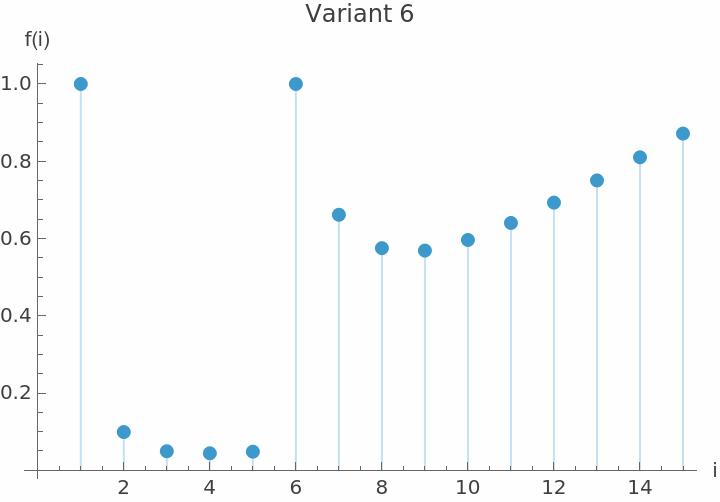

<p align="center"><b>МОНУ НТУУ КПІ ім. Ігоря Сікорського ФПСПМ СПіСКС</b></p>

<p align="center">
<b>Pозрахунково-графічна робота</b><br/>
дисципліни "Вступ до функціонального програмування"
</p>

<p align="right"><b>Студент</b>: Козлов Сергій Олександрович група КВ-33</p>
<p align="right"><b>Рік</b>: 2026</p>

## Загальне завдання
1. Реалізувати програму для обчислення функції згідно варіанту мовою Common Lisp.
2. Виконати тестування реалізованої програми.
3. Порівняти результати роботи програми мовою Common Lisp с розрахунками іншими
засобами.

## Варіант 6

$$F_1 = 1, \quad F_6 = 1$$

$$
F_i =
\begin{cases}
\sqrt{F_{i-1}} \cdot \ln(i) / 7, & i = 2 \ldots 5 \\
\sqrt{F_{i-1}} \cdot \sqrt{i} / 4, & i = 7 \ldots 15
\end{cases}
$$

## Лістинг реалізації завдання
```lisp
(defun f (i)
  (cond
   ((or (= i 1) (= i 6))
     1)
   ((<= 2 i 5)
     (* (sqrt (f (1- i))) (/ (log i) 7)))
   ((<= 7 i 15)
     (* (sqrt (f (1- i))) (/ (sqrt i) 4)))
   (t
     nil)))
```

### Тестові набори та утиліти
Числові результати порівнюються з точністю до `1e-6`. Очікувані значення обчислено за допомогою Wolfram (див. "Порівняння результатів").

```lisp
(defmacro test (description expr)
  `(format t "~a | ~:[FAIL~;PASS~]~%" ,description ,expr))

(defun approx-equal (actual expected)
  (<= (abs (- actual expected)) 1e-6))

;; simple case f(1)
(test "f(1)" (approx-equal (f 1) 1))

;; first branch, i = 2..5
(test "f(2)" (approx-equal (f 2) 0.09902102579427790d0))
(test "f(3)" (approx-equal (f 3) 0.04938671311461513d0))
(test "f(4)" (approx-equal (f 4) 0.04401112583216574d0))
(test "f(5)" (approx-equal (f 5) 0.04823446064062631d0))

;; simple case f(6)
(test "f(6)" (approx-equal (f 6) 1))

;; second branch, i = 7..15
(test "f(7)" (approx-equal (f 7) 0.6614378277661476d0))
(test "f(8)" (approx-equal (f 8) 0.5750816584478015d0))
(test "f(9)" (approx-equal (f 9) 0.5687560398596997d0))
(test "f(10)" (approx-equal (f 10) 0.5962151666238560d0))
(test "f(11)" (approx-equal (f 11) 0.6402327132019270d0))
(test "f(12)" (approx-equal (f 12) 0.6929462712948568d0))
(test "f(13)" (approx-equal (f 13) 0.7503458172250120d0))
(test "f(14)" (approx-equal (f 14) 0.8102793284243931d0))
(test "f(15)" (approx-equal (f 15) 0.8715714947139268d0))

;; outside the domain
(test "f(0) = NIL" (null (f 0)))
(test "f(16) = NIL" (null (f 16)))
(test "f(-1) = NIL" (null (f -1)))
```

### Результати тестування
```lisp
f(1) = 1 | PASS
f(2) | PASS
f(3) | PASS
f(4) | PASS
f(5) | PASS
f(6) = 1 | PASS
f(7) | PASS
f(8) | PASS
f(9) | PASS
f(10) | PASS
f(11) | PASS
f(12) | PASS
f(13) | PASS
f(14) | PASS
f(15) | PASS
f(0) = NIL | PASS
f(16) = NIL | PASS
f(-1) = NIL | PASS
```

## Порівняння результатів
Для порівняння функцію обчислено в Wolfram:

```wolfram
f[1] = 1; f[6] = 1;
f[i_ /; 2 <= i <= 5] := Sqrt[f[i - 1]] Log[i]/7;
f[i_ /; 7 <= i <= 15] := Sqrt[f[i - 1]] Sqrt[i]/4;

TableForm[Table[{i, N[f[i], 16]}, {i, 1, 15}],
  TableHeadings -> {None, {"i", "f(i)"}}]
```

| i  | Common Lisp        | Wolfram             |
|----|--------------------|---------------------|
| 1  | 1                  | 1.000000000000000   |
| 2  | 0.099021025        | 0.09902102579427790 |
| 3  | 0.049386717        | 0.04938671311461513 |
| 4  | 0.044011127        | 0.04401112583216574 |
| 5  | 0.048234463        | 0.04823446064062631 |
| 6  | 1                  | 1.000000000000000   |
| 7  | 0.6614378          | 0.6614378277661476  |
| 8  | 0.57508165         | 0.5750816584478015  |
| 9  | 0.56875604         | 0.5687560398596997  |
| 10 | 0.5962152          | 0.5962151666238560  |
| 11 | 0.64023274         | 0.6402327132019270  |
| 12 | 0.69294626         | 0.6929462712948568  |
| 13 | 0.7503458          | 0.7503458172250120  |
| 14 | 0.81027937         | 0.8102793284243931  |
| 15 | 0.87157154         | 0.8715714947139268  |

Результати збігаються приблизно до 7 значущих цифр. Значення, обчислені SBCL,
мають меншу кількість знаків, оскільки `log` та `sqrt` від цілих чисел
повертають числа одинарної точності (`single-float`), тоді як Wolfram обчислює
значення з точністю 16 знаків.

Графік функції, побудований у Wolfram:

```wolfram
plot = ListPlot[Table[{i, f[i]}, {i, 1, 15}],
  Filling -> Axis, PlotMarkers -> Automatic,
  AxesLabel -> {"i", "f(i)"}, PlotLabel -> "Variant 6"];
```


